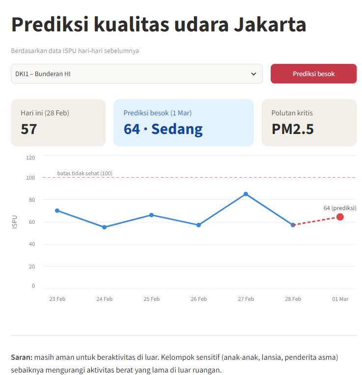
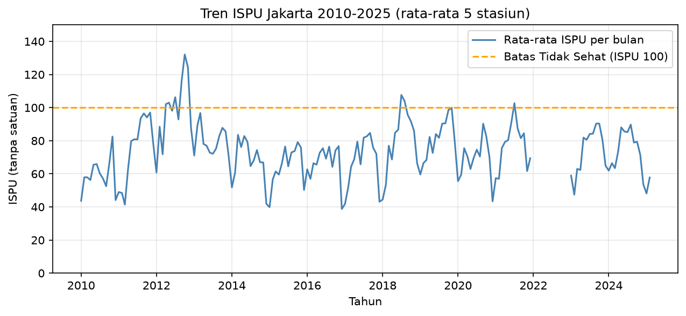
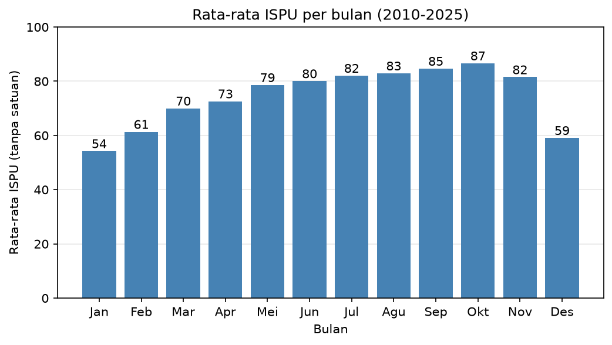
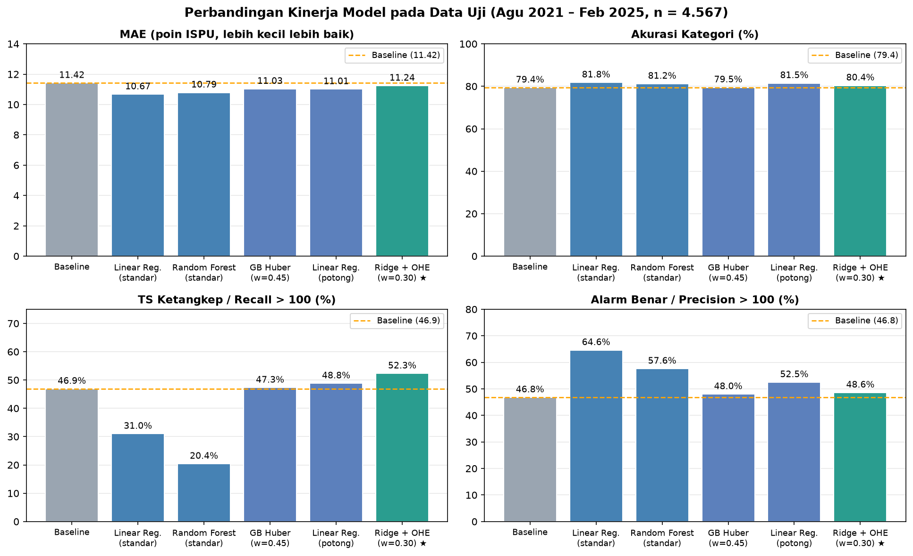

# Prediksi Kualitas Udara Jakarta

Aplikasi web yang memperkirakan **ISPU (Indeks Standar Pencemar Udara) besok** di 5 stasiun pemantau DKI Jakarta, lengkap dengan kategori kualitas udara dan saran yang perlu dilakukan warga.

Project ini kami buat untuk tugas AOL mata kuliah *Artificial Intelligence*, mulai dari mengolah data mentah, memilih model, sampai membangun aplikasinya.



---

## Daftar isi

1. [Kenapa kami membuat ini](#1-kenapa-kami-membuat-ini)
2. [Ringkasan hasil](#2-ringkasan-hasil)
3. [Gambaran besar alur kerja](#3-gambaran-besar-alur-kerja)
4. [Data](#4-data)
5. [Cara model melihat masalahnya](#5-cara-model-melihat-masalahnya)
6. [Apa yang kami temukan dari data (EDA)](#6-apa-yang-kami-temukan-dari-data-eda)
7. [Membangun dan memilih model](#7-membangun-dan-memilih-model)
8. [Aplikasi web](#8-aplikasi-web)
9. [Struktur folder](#9-struktur-folder)
10. [Menjalankan project](#10-menjalankan-project)
11. [Keterbatasan dan pertimbangan etika](#11-keterbatasan-dan-pertimbangan-etika)
12. [Pengembangan berikutnya](#12-pengembangan-berikutnya)

---

## 1. Kenapa kami membuat ini

**Masalahnya.** Data ISPU yang dipublikasikan hanya menunjukkan kondisi udara *saat ini*. Akibatnya, warga baru tahu udara sedang buruk ketika mereka sudah menghirupnya.

**Solusi kami.** Kami melatih model *machine learning* dari data ISPU bertahun-tahun untuk menebak kondisi udara **besok**. Dengan begitu, warga punya waktu untuk bersiap, misalnya memakai masker, mengurangi olahraga di luar, atau menutup jendela, sebelum udara memburuk.

**Kaitan dengan SDG.**
Project ini menjawab **SDG 11 (Kota dan Permukiman yang Berkelanjutan)**, pada permasalahan **polusi udara di wilayah padat penduduk** (*air pollution in densely populated areas*). Prediksi kualitas udara besok membantu warga Jakarta mengambil tindakan pencegahan sebelum terpapar udara buruk. Secara tidak langsung, project ini juga mendukung **SDG 3 (Kehidupan Sehat dan Sejahtera)** dengan membantu kelompok rentan seperti anak-anak, lansia, dan penderita asma.

---

## 2. Ringkasan hasil

| Hal | Hasil |
|---|---|
| Model terpilih | **Ridge Regression + One-Hot Encoding bulan**, dengan pembobotan kelas `SEDANG = 0,30` |
| Rata-rata tebakan meleset (MAE) | **11,24 poin ISPU** |
| Kategori tebakan yang benar | **80,4%** |
| Hari Tidak Sehat yang berhasil diperingatkan | **52,3%** (model standar hanya 31,0%) |
| Peringatan Tidak Sehat yang memang terjadi | **48,6%** |
| Ukuran file model | **3,3 KB** |
| Aplikasi | Web Streamlit satu halaman: pilih stasiun lalu lihat prediksi besok, grafik, dan saran |

Semua angka di atas diukur pada **data uji Agustus 2021 – Februari 2025**, yaitu data yang sama sekali tidak dilihat model saat latihan. Model ini mengalahkan *baseline* "besok sama dengan hari ini" di keempat metrik utama sekaligus.

---

## 3. Gambaran besar alur kerja

```
 Data mentah          Siapkan data            Latih model             Aplikasi
 (5 file CSV)  ──►  prepare_data.ipynb  ──►  train_model.ipynb  ──►  app.py
 data/raw/          data_siap.csv           models/model.pkl        Streamlit
                          │
                          └──►  eda.ipynb  (grafik untuk laporan)
```

Setiap tahap kami pisahkan ke file sendiri. Kalau ada yang salah, kami langsung tahu tahap mana yang bermasalah. Data mentah juga tidak pernah diubah; semua hasil olahan disimpan terpisah di `data/processed/`.

Semua konstanta yang dipakai bersama, seperti lokasi file, daftar fitur, dan aturan kategori ISPU, kami taruh di satu tempat: [`src/config.py`](src/config.py). Dengan begitu notebook dan aplikasi tidak mungkin memakai aturan yang berbeda.

---

## 4. Data

### Sumber

Kami memakai dataset Kaggle *Air Quality Index in Jakarta (2010–2021)* oleh **senadu34**. Data aslinya berasal dari **Satu Data Jakarta**. Dataset ini terdiri dari 5 file CSV, satu untuk setiap stasiun pemantau.

Meskipun judul dataset menyebut periode 2010–2021, file yang kami unduh dari Kaggle sudah berisi data hingga Februari 2025 karena dataset tersebut telah diperbarui oleh pembuatnya. Kami memakai kelima file itu apa adanya, tanpa menambahkan data dari sumber lain.

| Stasiun | Lokasi | Rentang data dipakai |
|---|---|---|
| DKI1 | Bunderan HI | 2010 – Feb 2025 |
| DKI2 | Kelapa Gading | 2010 – Feb 2025 |
| DKI3 | Jagakarsa | 2010 – Feb 2025 |
| DKI4 | Lubang Buaya | 2010 – Feb 2025 |
| DKI5 | Kebon Jeruk | 2012 – Feb 2025 |

Setiap baris berisi tanggal, stasiun, nilai indeks tiap polutan (PM2.5, PM10, SO₂, CO, O₃, NO₂), nilai `max` (ISPU harian), polutan kritis, dan kategori. **Data tahun 2022 tidak tersedia** di dataset per stasiun ini.

### Pembersihan data

Kami tidak langsung percaya pada data mentah. Di [`src/prepare_data.ipynb`](src/prepare_data.ipynb), setiap baris yang mencurigakan kami buang dan kami catat alasannya:

| Langkah | Baris dibuang |
|---|---:|
| Tanggal atau stasiun kosong | 0 |
| Baris dobel (tanggal dan stasiun sama) | 0 |
| Tidak ada pengukuran (`TIDAK ADA DATA`, `max` 0 atau kosong) | 2.409 |
| ISPU di atas 500 (tidak wajar) | 0 |
| Angka `max` tidak cocok dengan label kategorinya (data rusak) | 168 |
| **Total baris awal → baris valid** | **25.865 → 23.288** |

Langkah terakhir di tabel ini penting. Kalau angka ISPU-nya 120 tetapi labelnya "SEDANG", salah satunya pasti salah, jadi baris itu tidak kami pakai.

Setelah dibersihkan, data kami susun ulang per stasiun ke kalender harian penuh. Tanggal yang bolong tidak kami isi dengan tebakan; tanggal itu tetap kosong. Hanya baris yang punya ISPU kemarin, hari ini, **dan** besok yang dipakai untuk melatih model. Hasil akhirnya **22.835 baris** di [`data/processed/data_siap.csv`](data/processed/data_siap.csv). Ringkasan lengkapnya ada di [`data/processed/ringkasan_data.txt`](data/processed/ringkasan_data.txt).

---

## 5. Cara model melihat masalahnya

### Fitur dan target

Model pada dasarnya adalah fungsi `f(X) = ŷ`: diberi petunjuk `X`, model mengeluarkan tebakan `ŷ`.

| | Kolom | Arti |
|---|---|---|
| **Fitur (X)** | `ispu_hari_ini` | ISPU hari ini |
| | `ispu_kemarin` | ISPU kemarin |
| | `bulan` | Bulan (1–12), untuk menangkap pola musiman |
| | `hari` | Hari dalam seminggu (0 = Senin … 6 = Minggu) |
| **Target (y)** | `ispu_besok` | ISPU besok, yaitu yang ingin ditebak |

Kolom kemarin dan besok kami buat dengan **menggeser** data ISPU per stasiun (`shift(1)` dan `shift(-1)`). Hasilnya, setiap baris punya nilai kemarin, hari ini, dan besok yang sejajar. Pergeseran ini dilakukan *per stasiun* supaya data antarstasiun tidak tercampur.

### Kenapa menebak besok, bukan hari ini

Kategori ISPU dihitung langsung dari angka polutan pada hari yang sama:

```
ISPU = max(ISPU PM10, ISPU PM2.5, ISPU SO2, ISPU CO, ISPU O3, ISPU NO2)
```

Kalau model menebak kategori *hari ini* memakai angka polutan *hari ini*, jawabannya sudah ada di soal. Akurasinya pasti hampir 100%, tetapi model seperti itu tidak berguna. Ini yang disebut **data leakage**. Karena itu, model kami hanya boleh memakai informasi **hari ini dan sebelumnya** untuk menebak **besok**.

### Angka dulu, baru kategori

Model kami mengeluarkan **angka ISPU**, bukan kategori. Angka itu kemudian dicocokkan ke tabel resmi di bawah ini. Pencocokan ini aturan tetap (if-else biasa), bukan sesuatu yang dipelajari model:

| Nilai ISPU | Kategori |
|---|---|
| 0 – 50 | Baik |
| 51 – 100 | Sedang |
| 101 – 200 | Tidak Sehat |
| 201 – 300 | Sangat Tidak Sehat |
| > 300 | Berbahaya |

---

## 6. Apa yang kami temukan dari data (EDA)

Eksplorasi data ada di [`src/eda.ipynb`](src/eda.ipynb). Temuan inilah yang membentuk keputusan kami saat memodelkan:

- **ISPU hari ini adalah petunjuk terkuat.** Korelasinya dengan ISPU besok **0,71**. ISPU kemarin juga membantu (**0,61**). Artinya, kualitas udara cenderung "bertahan" dari hari ke hari.
- **Ada pola musiman yang jelas.** Rata-rata ISPU terendah di **Januari (54)** dan naik bertahap sampai puncaknya di **Oktober (87)** saat musim kemarau, lalu turun tajam di Desember. Pola naik-turun seperti ini tidak lurus, sehingga kami memperlakukan `bulan` sebagai kategori (*one-hot encoding*), bukan angka 1–12 biasa.
- **Pengaruh hari dalam seminggu kecil.** Selisih rata-rata hari tertinggi dan terendah hanya **2,7 poin**.
- **Datanya tidak seimbang.** Sebagian besar hari berkategori Sedang (68,5%), lalu Baik (18,0%), sedangkan Tidak Sehat hanya 12,7%, Sangat Tidak Sehat 0,9%, dan Berbahaya hanya 1 hari. Ini masalah besar, karena justru hari Tidak Sehat yang paling penting untuk diperingatkan.

| Grafik | Isi |
|---|---|
|  | Tren ISPU bulanan 2010–2025 |
|  | Pola musiman: puncak di Oktober |

Grafik lainnya (hari ini vs besok, distribusi kategori, ketersediaan data, pola per hari) ada di [`reports/figures/`](reports/figures/).

---

## 7. Membangun dan memilih model

Seluruh proses ini ada di [`src/train_model.ipynb`](src/train_model.ipynb). Pembahasan lengkapnya ada di [`reports/laporan_model.md`](reports/laporan_model.md).

### Membagi data berdasarkan waktu

Data kami adalah deret waktu, jadi **tidak boleh diacak**. Kalau diacak, model bisa belajar dari tahun 2024 lalu "diuji" di tahun 2015, sama seperti mengintip masa depan. Karena itu, kami membagi data secara kronologis:

| Bagian | Baris | Rentang | Kegunaan |
|---|---:|---|---|
| Sub-latih (64%) | 14.614 | Jan 2010 – Jun 2019 | Melatih model saat eksperimen |
| Validasi (16%) | 3.654 | Jun 2019 – Agu 2021 | Memilih model dan setelan terbaik |
| Uji (20%) | 4.567 | Agu 2021 – Feb 2025 | Penilaian akhir, **hanya dipakai sekali** |

Setelah model terbaik terpilih di data validasi, model itu dilatih ulang memakai sub-latih ditambah validasi (80%), lalu dinilai satu kali di data uji.

### Pembanding minimal: baseline

Sebuah model baru layak dipakai kalau lebih pintar dari tebakan paling malas. Kami memakai **baseline persistensi**: *"ISPU besok sama dengan ISPU hari ini"*. Karena korelasi hari ini–besok sudah 0,71, baseline ini ternyata cukup sulit dikalahkan.

### Cara kami menilai model

Melihat MAE saja tidak cukup. Model bisa punya MAE kecil hanya karena selalu menebak "Sedang". Karena itu, kami menilai empat hal sekaligus:

1. **MAE:** rata-rata selisih tebakan dengan nilai asli. Makin kecil makin bagus.
2. **Akurasi kategori:** seberapa sering kategori tebakan sama dengan kategori asli.
3. **TS ketangkep (*recall* > 100):** dari hari yang benar-benar Tidak Sehat, berapa persen yang berhasil diperingatkan.
4. **Alarm benar (*precision* > 100):** dari semua peringatan Tidak Sehat, berapa persen yang memang terjadi.

**Syarat model terpilih:** harus mengalahkan baseline di **keempat** metrik sekaligus.

### Model yang kami coba

Kami membandingkan empat jenis model: **Linear Regression**, **Ridge + One-Hot Encoding bulan**, **Random Forest**, dan **Gradient Boosting (Huber loss)**.

Temuan pertama kami cukup mengejutkan. Tanpa penanganan khusus, **semua model kalah dari baseline dalam menangkap hari Tidak Sehat**. Karena kategori Sedang mendominasi data, model belajar untuk "main aman" dan menebak angka di tengah-tengah. Linear Regression standar misalnya hanya menangkap 31% hari Tidak Sehat, sedangkan baseline menangkap 47%.

Untuk mengatasinya, kami mencoba dua cara. Keduanya **hanya diterapkan pada data latih**; data validasi dan uji tetap asli.

- **Undersampling:** membuang sebagian hari Sedang secara acak.
- **Pembobotan (`sample_weight`):** semua data tetap dipakai, tetapi hari Sedang diberi bobot lebih kecil. Setelannya kami cari di data validasi, dan bobot 0,30 untuk Ridge yang terbaik.

Kami memilih pembobotan karena tidak ada data yang dibuang dan hasilnya selalu sama setiap kali dijalankan, tanpa unsur acak.

### Hasil di data uji

| Model | MAE ↓ | Akurasi kategori ↑ | TS ketangkep ↑ | Alarm benar ↑ | Kalahkan baseline di semua metrik? |
|---|---:|---:|---:|---:|:---:|
| Baseline (besok = hari ini) | 11,42 | 79,4% | 46,9% | 46,8% | — |
| Linear Regression | 10,67 | 81,8% | 31,0% | 64,6% | Tidak |
| Ridge + OHE bulan | 10,55 | 82,2% | 31,4% | 63,8% | Tidak |
| Random Forest | 10,79 | 81,2% | 20,4% | 57,6% | Tidak |
| Gradient Boosting Huber | 10,63 | 81,3% | 9,7% | 73,8% | Tidak |
| Gradient Boosting Huber (bobot Sedang 0,45) | 11,03 | 79,5% | 47,3% | 48,0% | Ya |
| **Ridge + OHE bulan (bobot Sedang 0,30) ★** | **11,24** | **80,4%** | **52,3%** | **48,6%** | **Ya** |



### Kenapa kami memilih Ridge + OHE bulan (bobot Sedang 0,30)

1. **Konsisten mengalahkan baseline di semua metrik,** baik di data validasi maupun uji. Model ini juga menangkap hari Tidak Sehat paling banyak (52,3%), naik 21 poin dibanding Linear Regression standar.
2. **Lebih jujur terhadap hari Tidak Sehat.** Model menebak > 100 di 10,9% hari uji, sangat dekat dengan kenyataannya (10,2%). Model standar hanya berani menebak > 100 di 4,9% hari.
3. **Mudah dijelaskan.** Koefisiennya masuk akal dan sesuai dengan temuan EDA:
   - ISPU hari ini berbobot **+0,619** dan ISPU kemarin **+0,245**;
   - efek bulan naik dari Januari (+0) sampai puncaknya di September–Oktober (**+11,8** dan **+11,9**), lalu kembali turun di Desember;
   - efek hari dalam seminggu kecil (**−0,481**).
4. **Ringan dan stabil.** File model hanya 3,3 KB, langsung termuat di aplikasi, dan hanya memakai komponen standar `scikit-learn`. Model ini juga lebih tahan terhadap perubahan pola data setelah 2021 dibanding Gradient Boosting.

Ada konsekuensi yang kami terima dengan sadar: dibanding model tanpa pembobotan, MAE model ini sedikit lebih besar dan alarm palsunya sedikit lebih banyak. Untuk urusan kesehatan, lebih baik sesekali memperingatkan tanpa perlu daripada diam saat udara benar-benar buruk.

### Kinerja per stasiun

| Stasiun | MAE | Akurasi kategori | TS ketangkep |
|---|---:|---:|---:|
| DKI1 (Bunderan HI) | 10,17 | 79,5% | 18,8% |
| DKI2 (Kelapa Gading) | 10,08 | 82,3% | 29,0% |
| DKI3 (Jagakarsa) | 11,46 | 87,8% | 17,9% |
| DKI4 (Lubang Buaya) | 13,33 | 77,7% | 71,1% |
| DKI5 (Kebon Jeruk) | 11,21 | 74,6% | 42,2% |

Lebih dari separuh hari Tidak Sehat di periode uji terjadi di **DKI4 (Lubang Buaya)**, dan di stasiun ini model menangkap 71% di antaranya. Di stasiun yang jarang Tidak Sehat (DKI1 dan DKI3), lonjakan biasanya terjadi mendadak sehingga jauh lebih sulit ditebak hanya dari riwayat ISPU.

---

## 8. Aplikasi web

Aplikasi kami bangun dengan **Streamlit** di [`app.py`](app.py), mengikuti rancangan MVP di dokumen alur kerja kelompok.

### Yang dilihat pengguna

1. **Dropdown stasiun dan tombol "Prediksi besok".**
2. **Tiga kartu informasi:**
   - **Hari ini:** ISPU terbaru dari data;
   - **Prediksi besok:** angka tebakan model beserta kategorinya, dengan warna kartu mengikuti warna kategori ISPU (hijau, biru, kuning, merah, hitam);
   - **Polutan kritis:** polutan dengan indeks tertinggi hari ini, misalnya PM2.5.
3. **Grafik:** garis biru adalah ISPU asli 6 hari terakhir, titik merah adalah prediksi besok, dan garis putus-putus menandai batas tidak sehat (100).
4. **Saran** sesuai kategori, misalnya "pakai masker saat di luar, kurangi olahraga outdoor, dan tutup jendela di siang hari".
5. **Keterangan** bahwa angka besok adalah prediksi statistik dan bukan informasi resmi.

### Yang terjadi di balik layar

1. Saat aplikasi dibuka, 5 file data mentah dibaca lalu **dibersihkan dengan aturan yang persis sama** seperti `prepare_data.ipynb`. Model dan data hanya dimuat sekali lalu disimpan di *cache*, jadi aplikasi tetap cepat.
2. Untuk stasiun yang dipilih, aplikasi mencari **tanggal terbaru yang punya data hari ini dan kemarin**, karena model butuh keduanya.
3. Empat fitur (`ispu_hari_ini`, `ispu_kemarin`, `bulan`, `hari`) disusun dalam urutan yang sama persis dengan saat training, lalu dikirim ke `model.predict()`.
4. Hasil prediksi dibatasi ke rentang 0–500, lalu dicocokkan ke tabel kategori dengan fungsi `kategori_ispu()` dari `config.py`, yaitu fungsi yang sama yang dipakai saat menyiapkan data.

> **Catatan:** dataset kami berakhir pada **28 Februari 2025**, jadi "hari ini" di aplikasi adalah tanggal tersebut, dan "besok" adalah 1 Maret 2025. Aplikasi belum tersambung ke data ISPU *real-time*.

---

## 9. Struktur folder

```
prediksi-udara/
├── app.py                      ← aplikasi web Streamlit
├── requirements.txt            ← daftar library
├── data/
│   ├── raw/                    ← data asli dari Kaggle, tidak pernah diubah
│   │   └── ispu_dki1.csv … ispu_dki5.csv
│   └── processed/
│       ├── data_siap.csv       ← tabel fitur + target siap latih
│       └── ringkasan_data.txt  ← catatan pembersihan data
├── src/
│   ├── config.py               ← lokasi file, daftar fitur, aturan kategori ISPU
│   ├── prepare_data.ipynb      ← tahap 2: bersihkan & susun data
│   ├── eda.ipynb               ← eksplorasi data & grafik laporan
│   └── train_model.ipynb       ← tahap 3: latih, bandingkan, dan simpan model
├── models/
│   └── model.pkl               ← model final (±3 KB)
└── reports/
    ├── laporan_model.md        ← pembahasan lengkap bagian model
    └── figures/                ← semua grafik (1–9) + tampilan aplikasi (10)
```

---

## 10. Menjalankan project

### Persiapan

Butuh **Python 3.12** (sudah dites juga di 3.13) dan **Git**.

```
git clone https://github.com/aol-ai-udara-jakarta/prediksi-udara.git
cd prediksi-udara
python -m venv venv
venv\Scripts\activate
pip install -r requirements.txt
```

- Di Mac/Linux, ganti baris aktivasi dengan `source venv/bin/activate`.
- Kalau muncul error *"running scripts is disabled"* di PowerShell, jalankan sekali:
  ```
  Set-ExecutionPolicy -Scope CurrentUser RemoteSigned
  ```
- Setiap membuka terminal baru, aktifkan lagi venv. Pastikan muncul `(venv)` di depan baris terminal.
- Untuk membuka notebook di VS Code, pilih **Select Kernel → Python Environments → venv**.

### Langsung buka aplikasinya

`data_siap.csv` dan `model.pkl` sudah ada di repository, jadi kamu bisa langsung menjalankan:

```
streamlit run app.py
```

Browser akan terbuka di `http://localhost:8501`. Pilih stasiun, lalu tekan **Prediksi besok**.

### Mengulang seluruh proses dari awal

Jalankan berurutan. Untuk setiap notebook, klik **Restart → Run All**.

| Urutan | File | Hasil |
|---|---|---|
| 1 | `src/prepare_data.ipynb` | `data/processed/data_siap.csv` dan `ringkasan_data.txt` |
| 2 | `src/eda.ipynb` | Grafik 1–6 di `reports/figures/` |
| 3 | `src/train_model.ipynb` | `models/model.pkl` dan grafik 7–9 di `reports/figures/` |
| 4 | `streamlit run app.py` | Aplikasi web di browser |

### Untuk developer: kontrak model

Kalau ingin memakai model di kode lain (contoh ini dijalankan dari folder `src/`):

```python
import joblib, pandas as pd
from config import MODEL_PATH, FITUR, kategori_ispu

model = joblib.load(MODEL_PATH)
X = pd.DataFrame([[125, 118, 11, 2]], columns=FITUR)  # hari ini, kemarin, bulan, hari
ispu_besok = model.predict(X)[0]
print(round(ispu_besok), kategori_ispu(round(ispu_besok)))
```

Kolom harus bernama dan berurutan persis seperti `FITUR` di `src/config.py`.

---

## 11. Keterbatasan dan pertimbangan etika

Kami ingin jujur soal batas kemampuan model ini:

- **Lonjakan mendadak sulit ditebak.** Di data uji, 53% hari Tidak Sehat datang setelah hari yang masih ≤ 100. Tanpa informasi tambahan seperti cuaca, arah angin, atau kejadian emisi, model yang hanya melihat riwayat ISPU secara alami akan kesulitan menangkap lonjakan seperti ini. Kami sempat mencoba menambah fitur (lag 2 hari, rata-rata 7 hari, identitas stasiun, data cuaca ERA5), tetapi peningkatannya hanya sekitar 0,5 poin akurasi. Itu tidak sepadan dengan kerumitan menyambungkan API cuaca ke aplikasi.
- **Akurasi kategori sekitar 80%.** Ini wajar untuk prediksi kualitas udara harian dengan fitur sesederhana ini. Di beberapa stasiun (misalnya DKI3), akurasinya mencapai 87,8%.
- **Salah diam lebih berbahaya daripada salah alarm.** Kesalahan paling berbahaya adalah model bilang "Sedang" padahal besok Tidak Sehat, sehingga kelompok rentan tetap beraktivitas di luar tanpa perlindungan. Karena itu, kami sengaja membuat model sedikit lebih waspada, dengan konsekuensi beberapa alarm palsu.
- **Hanya 5 titik pengukuran.** Pola polusi antarwilayah sangat berbeda (DKI4 jauh lebih sering Tidak Sehat dibanding DKI1). Prediksi satu stasiun belum tentu mewakili kualitas udara di seluruh lingkungan sekitarnya.
- **Bukan informasi resmi.** Angka di aplikasi adalah prediksi statistik dari data historis, bukan pengumuman pemerintah, BMKG, atau DLH DKI Jakarta. Keterangan ini juga kami tampilkan langsung di aplikasi.

---

## 12. Pengembangan berikutnya

- **Data real-time:** menyambungkan aplikasi ke sumber ISPU terbaru supaya "hari ini" benar-benar hari ini.
- **Prediksi lebih dari satu hari:** misalnya perkiraan 3 hari ke depan.
- **Notifikasi:** memberi peringatan otomatis saat besok diperkirakan Tidak Sehat.
- **Deploy:** menerbitkan aplikasi ke Streamlit Community Cloud agar bisa diakses publik.
